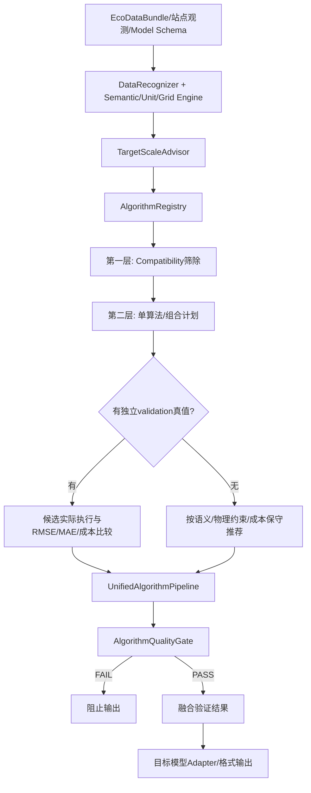

# EcoData Engine 智能跨尺度融合算法框架设计

## 目标与边界

该框架统一管理已有重采样、融合、QP 和 Neural Operator，不替换它们的算法核心。
新增算法可以通过 `ecodata.algorithms` entry point 注册，不要求修改核心 Pipeline。

“目标网格更密”只代表输出采样间隔更小。没有独立高分辨率真值时，框架只报告
粗尺度一致性、守恒、有限值、单位、CRS 和稳定性，不生成“精度提高”结论。

## 架构



## 稳定接口

- `AlgorithmSpec`：算法ID、版本、类别、状态、输入类型、语义、尺度范围、训练/权重/
  辅助数据要求、物理约束、算力、许可证、后端和官方来源。
- `AlgorithmContext`：统一输入数据、变量、语义、目标网格、训练观测、辅助变量、
  validation参考、模型约束和参数。
- `AlgorithmPlugin.compatibility()`：只判断能否运行并解释原因，不静默降级。
- `AlgorithmPlugin.run()`：返回 `AlgorithmResult`，必须保留 `EcoDataBundle`、history和报告。
- `AlgorithmRegistry`：内置注册加 Python entry point 自动发现。
- `AlgorithmSelector`：先筛除，再生成计划；有 validation 时实跑并比较，没有时不冒充精度选型。
- `UnifiedAlgorithmPipeline`：组合执行，每一步重新检查兼容性。
- `AlgorithmQualityGate`：变量、单位、有限值、CRS和变量物理范围守门；FAIL 阻止输出。

## 自动尺度决策

优先级：用户明确目标网格 → 目标模型 Schema 网格 → 保持源网格。

| 数据语义 | 默认方法 | 约束 |
|---|---|---|
| 分类量 | nearest | 禁止双线性制造新类别 |
| 连续场/密度 | bilinear | 加密不等于真实精度提高 |
| cell_total/flux/accumulation | conservative | 必须检查支持域和守恒 |
| 字符串/标识符 | 不做空间数值插值 | 仅保留或显式映射 |
| 有训练站连续观测 | IDW/Kriging/残差融合/QP候选 | validation与test隔离 |

## 自动选型层级

1. `compatibility` 按语义、数据数量、目标网格、观测、辅助变量、权重和依赖筛除。
2. `recommend` 生成单算法；尺度统一后残差融合可生成组合计划。
3. `select` 仅在 `validation_role=validation` 时比较独立 RMSE/MAE/bias 和运行时间。
4. 最终 test 角色直接拒绝参与选型。所有候选先通过物理质量门再进入排名。

## 插件状态定义

- `available`：当前环境实际可调用，并有自动测试或既有回归覆盖。
- `dependency_missing`：接口/来源已核实，但运行依赖或合格权重不具备。
- `research_only`：只完成候选调研，不能运行、不能出现在自动推荐中。

高级单图超分辨率算法不能与 FNO/UNO 简单拼接。未来接入 ZSSR/Thera/LIIF 时，
必须通过单独 Adapter 把环境变量、单位、CRS、NoData、退化核、训练边界和反向聚合
一致性显式化，并增加对应真实数据测试。

## 扩展示例

外部包暴露 entry point：

```toml
[project.entry-points."ecodata.algorithms"]
my_algorithm = "my_package.plugin:MyAlgorithmPlugin"
```

插件实现 `spec`、`compatibility(context)` 和 `run(context)` 即可。核心 Registry、
Router、Pipeline 无需修改。

